# Fan-Out & Fan-In

Fan-out, fan-in, and round-robin patterns are provided by [goflow](https://github.com/foomo/goflow). Use the `bridge.ToStream` function to convert a goflux `Subscriber[T]` into a `goflow.Stream` and apply goflow operators.

## Broadcast (Tee)

`Tee` sends every element to all output streams -- equivalent to broadcasting a message to multiple destinations.

::: code-group

<div class="vp-block active" data-title="Diagram"></div>

```go [Code]
stream := bridge.ToStream[Event](ctx, sub, "events.>", 16)

// Broadcast to 3 consumers.
streams := stream.Tee(3)

// Each stream receives every message.
gofuncy.Go(ctx, func(ctx context.Context) error {
    return streams[0].ForEach(func(ctx context.Context, msg goflux.Message[Event]) error {
        return archiveEvent(ctx, msg.Payload)
    })
})

gofuncy.Go(ctx, func(ctx context.Context) error {
    return streams[1].ForEach(func(ctx context.Context, msg goflux.Message[Event]) error {
        return indexEvent(ctx, msg.Payload)
    })
})

streams[2].ForEach(func(ctx context.Context, msg goflux.Message[Event]) error {
    return notifyEvent(ctx, msg.Payload)
})
```

:::

## Round-Robin (FanOut)

`FanOut` distributes elements across output streams in round-robin order -- useful for load balancing.

::: code-group

<div class="vp-block active" data-title="Diagram"></div>

```go [Code]
stream := bridge.ToStream[Job](ctx, sub, "jobs.>", 16)

// Distribute across 3 worker streams.
workers := stream.FanOut(3)

for _, w := range workers {
    gofuncy.Go(ctx, func(ctx context.Context) error {
        return w.ForEach(func(ctx context.Context, msg goflux.Message[Job]) error {
            return processJob(ctx, msg.Payload)
        })
    })
}
```

:::

## Fan-In (Merge)

`FanIn` merges multiple streams into one. Combine with `ToStream` on each subscriber to merge messages from different sources.

::: code-group

<div class="vp-block active" data-title="Diagram"></div>

```go [Code]
streamA := bridge.ToStream[Metric](ctx, subA, "metrics.>", 16)
streamB := bridge.ToStream[Metric](ctx, subB, "metrics.>", 16)

merged := goflow.FanIn([]goflow.Stream[goflux.Message[Metric]]{streamA, streamB})

merged.ForEach(func(ctx context.Context, msg goflux.Message[Metric]) error {
    fmt.Printf("%s = %.2f\n", msg.Payload.Name, msg.Payload.Value)
    return nil
})
```

:::

## Publishing Results

Use `FromStream` to publish processed stream elements to a publisher:

```go
stream := bridge.ToStream[RawEvent](ctx, sub, "events.raw", 16)

// Filter and forward to a different transport.
filtered := stream.Filter(func(_ context.Context, msg goflux.Message[RawEvent]) bool {
    return msg.Payload.Priority > 5
})

err := bridge.FromStream(filtered, dstPub)
```
