# HTTP Ingest with Batched Storage

Several HTTP endpoints accept webhooks in their own formats. Each endpoint converts its payload into one common `Event` type and publishes it to NATS. A group of store services subscribes to the events and writes them to the database in batches, one transaction per batch.

## How It Works

- **Ingest service** -- one `gofluxhttp.Subscriber` per payload type. Its handler maps the payload to an `Event` and publishes it on `events.<source>`. The endpoint answers `204` only after the publish succeeds, and `500` if it fails, so the sender can retry.
- **Store service** -- a `gofluxnats.Subscriber` in the queue group `event-store`. NATS delivers each event to one instance, so you can run as many instances as the database load needs.
- **Batching** -- `bridge.ToStream` turns the subscriber into a goflow stream. `goflow.Batch` flushes at `MaxItems` or after `MaxWait`, whichever comes first, so a quiet period does not hold events back.

::: code-group

<div class="vp-block active" data-title="Diagram">; the store queue group splits the events between Store A and Store B, each collects a batch of 2 and inserts it into the database in one transaction"></div>

```go [Code]
package main

import (
	"context"
	"database/sql"
	"log"
	"log/slog"
	"net/http"
	"time"

	json "github.com/foomo/goencode/json/v1"
	"github.com/foomo/goflow"
	"github.com/foomo/goflux"
	"github.com/foomo/goflux/bridge"
	gofluxhttp "github.com/foomo/goflux/transport/http"
	gofluxnats "github.com/foomo/goflux/transport/nats"
	"github.com/nats-io/nats.go"
)

// Webhook payloads, one type per HTTP source.
type OrderWebhook struct {
	OrderID string `json:"order_id"`
	Status  string `json:"status"`
}

type PaymentWebhook struct {
	PaymentID string `json:"payment_id"`
	OrderID   string `json:"order_id"`
	State     string `json:"state"`
}

// Event is the common type every source is converted into.
type Event struct {
	Type    string    `json:"type"`
	OrderID string    `json:"order_id"`
	Status  string    `json:"status"`
	At      time.Time `json:"at"`
}

// Ingest service: HTTP in, NATS out.
func ingest(ctx context.Context, nc *nats.Conn) error {
	pub := gofluxnats.NewPublisher[Event](nc, json.NewCodec[Event]().Encode)

	orders := gofluxhttp.NewSubscriber[OrderWebhook](json.NewCodec[OrderWebhook]().Decode)
	payments := gofluxhttp.NewSubscriber[PaymentWebhook](json.NewCodec[PaymentWebhook]().Decode)

	mux := http.NewServeMux()
	mux.Handle("/webhooks/orders", orders.Handler("webhooks.orders",
		func(ctx context.Context, msg goflux.Message[OrderWebhook]) error {
			return pub.Publish(ctx, "events.order", Event{
				Type: "order." + msg.Payload.Status, OrderID: msg.Payload.OrderID,
				Status: msg.Payload.Status, At: time.Now(),
			})
		}))
	mux.Handle("/webhooks/payments", payments.Handler("webhooks.payments",
		func(ctx context.Context, msg goflux.Message[PaymentWebhook]) error {
			return pub.Publish(ctx, "events.payment", Event{
				Type: "payment." + msg.Payload.State, OrderID: msg.Payload.OrderID,
				Status: msg.Payload.State, At: time.Now(),
			})
		}))

	srv := &http.Server{Addr: ":8080", Handler: mux, ReadHeaderTimeout: 5 * time.Second}
	go func() {
		<-ctx.Done()
		_ = srv.Shutdown(context.Background())
	}()

	return srv.ListenAndServe()
}

// Store service: NATS in, database out in batches.
func store(ctx context.Context, nc *nats.Conn, db *sql.DB) error {
	// Every store instance joins the queue group, so each event is stored once.
	sub := gofluxnats.NewSubscriber[Event](nc, json.NewCodec[Event]().Decode,
		gofluxnats.WithQueueGroup("event-store"))

	events := bridge.ToStream[Event](ctx, sub, "events.>", 1024)

	// Flush at 500 events or after 1s, whichever comes first.
	batches := goflow.Batch(events, goflow.MaxItems(500), goflow.MaxWait(time.Second))

	return batches.ForEach(func(ctx context.Context, batch []goflux.Message[Event]) error {
		return insertEvents(ctx, db, batch)
	}, goflow.WithErrorHandler(func(ctx context.Context, err error) {
		slog.ErrorContext(ctx, "insert batch", "error", err)
	}))
}

func insertEvents(ctx context.Context, db *sql.DB, batch []goflux.Message[Event]) error {
	tx, err := db.BeginTx(ctx, nil)
	if err != nil {
		return err
	}
	defer func() { _ = tx.Rollback() }()

	stmt, err := tx.PrepareContext(ctx,
		`INSERT INTO events (type, order_id, status, at) VALUES ($1, $2, $3, $4)`)
	if err != nil {
		return err
	}
	defer stmt.Close()

	for _, msg := range batch {
		e := msg.Payload
		if _, err := stmt.ExecContext(ctx, e.Type, e.OrderID, e.Status, e.At); err != nil {
			return err
		}
	}

	return tx.Commit()
}
```

:::

The ingest and store functions usually run in separate services. Other subscribers on `events.>` without the queue group, for example a notification service, still receive every event.

## No Event Loss with JetStream

With NATS core, events are lost when no store instance is running, and an event in an unflushed batch is lost when the store crashes or the insert fails. To keep them, publish with the JetStream publisher and consume with a JetStream subscriber in manual-ack mode. Ack every message of a batch after the commit and nak them when the insert fails:

```go
sub := gofluxjs.NewSubscriber[Event](consumer, codec.Decode, gofluxjs.WithManualAck())

events := bridge.ToStream[Event](ctx, sub, "events.>", 1024)
batches := goflow.Batch(events, goflow.MaxItems(500), goflow.MaxWait(time.Second))

err := batches.ForEach(func(ctx context.Context, batch []goflux.Message[Event]) error {
	err := insertEvents(ctx, db, batch)
	for _, msg := range batch {
		if err != nil {
			_ = msg.Nak()
		} else {
			_ = msg.Ack()
		}
	}
	return err
}, goflow.WithErrorHandler(logInsertError))
```

Several store instances share one consumer, so JetStream splits the events between them like a queue group. Keep the consumer's `AckWait` longer than `MaxWait` plus the insert time, and `MaxAckPending` at least as large as `MaxItems`. Otherwise JetStream redelivers events that wait in a batch, or stops delivering before a batch is full. A redelivered batch can be inserted twice, so make the insert idempotent, for example with a unique event ID and `ON CONFLICT DO NOTHING`.

## When to Use

- **Many webhook sources, one event model** -- downstream services depend on `Event`, not on each provider's payload.
- **High write volume** -- one transaction per batch costs far less than one per event.
- **Independent scaling** -- ingest scales with HTTP traffic, store instances scale with database throughput.
