# Pull Consumer

goflux's JetStream `Subscriber[T]` wraps a `jetstream.Consumer`, which is always a pull consumer, and calls its `Consume()` method internally. Pull timing is tuned with `WithConsumeOpts`, ack behavior with the consumer's `AckPolicy`, `WithManualAck()` and middleware.

## How It Works

Use a consumer with `AckPolicy: jetstream.AckExplicitPolicy` (the nats.go default) and combine the subscriber with middleware for concurrency control, auto-ack, and retry policies.

## JetStream Pull Consumer with Middleware

::: code-group

<div class="vp-block active" data-title="Diagram"></div>

```go [Code]
package main

import (
	"context"
	"fmt"
	"log"
	"time"

	json "github.com/foomo/goencode/json/v1"
	"github.com/foomo/goflux"
	"github.com/foomo/goflux/bridge"
	"github.com/foomo/goflux/middleware"
	gofluxjs "github.com/foomo/goflux/transport/jetstream"
	"github.com/nats-io/nats.go"
	"github.com/nats-io/nats.go/jetstream"
)

type Task struct {
	ID      string
	Payload string
}

func main() {
	ctx, cancel := context.WithCancel(context.Background())
	defer cancel()

	nc, _ := nats.Connect(nats.DefaultURL)
	defer nc.Drain()

	js, _ := jetstream.New(nc)
	stream, _ := js.CreateOrUpdateStream(ctx, jetstream.StreamConfig{
		Name:     "TASKS",
		Subjects: []string{"tasks.>"},
	})

	// Pull consumer with explicit ack policy.
	cons, _ := stream.CreateOrUpdateConsumer(ctx, jetstream.ConsumerConfig{
		Durable:   "batch-worker",
		AckPolicy: jetstream.AckExplicitPolicy,
	})

	codec := json.NewCodec[Task]()

	// Create a subscriber from the pull consumer.
	sub := gofluxjs.NewSubscriber[Task](cons, codec.Decode, gofluxjs.WithManualAck())

	// Use bridge.ToStream to bridge into goflow for stream processing.
	tasks := bridge.ToStream[Task](ctx, sub, "tasks.>", 16)

	// Process with bounded concurrency via goflow.
	policy := middleware.NewRetryPolicy(5 * time.Second)
	if err := tasks.Process(5, func(ctx context.Context, msg goflux.Message[Task]) error {
		fmt.Printf("processing task %s\n", msg.Payload.ID)
		err := processTask(msg.Payload)
		if err != nil {
			d := policy(err, msg.Delivery())
			switch d.Action {
			case middleware.RetryNak:
				return msg.Nak()
			case middleware.RetryNakWithDelay:
				return msg.NakWithDelay(d.Delay)
			case middleware.RetryTerm:
				return msg.Term()
			}
		}
		return msg.Ack()
	}); err != nil {
		log.Fatal(err)
	}
}

func processTask(_ Task) error { return nil }
```

:::

## Processing Patterns

### Stream-based (goflow)

Use `ToStream` + goflow `Process` for bounded concurrency with stream operators:

```go
tasks := bridge.ToStream[Task](ctx, sub, "tasks.>", 16)

tasks.Process(10, func(ctx context.Context, msg goflux.Message[Task]) error {
    err := myHandler(ctx, msg)
    if err != nil {
        return msg.Nak()
    }
    return msg.Ack()
})
```

### Handler-based (middleware)

Use `Chain` + middleware for simple auto-ack or retry-aware ack:

```go
// Simple auto-ack.
handler := goflux.Chain[Task](
	middleware.AutoAck[Task](),
)(myHandler)

// Retry-aware ack with custom policy.
policy := middleware.RetryPolicy(func(err error, delivery goflux.Delivery) middleware.RetryDecision {
	if goflux.IsNonRetryable(err) || delivery.NumDelivered >= 10 {
		return middleware.RetryDecision{Action: middleware.RetryTerm}
	}
	return middleware.RetryDecision{Action: middleware.RetryNakWithDelay, Delay: 5 * time.Second}
})

handler := goflux.Chain[Task](
	middleware.RetryAck[Task](policy),
)(myHandler)
```

### Growing backoff and long-running handlers

`NewBackoffRetryPolicy` grows the nak delay with the JetStream delivery count (`initial * factor^(NumDelivered-1)`, capped). `KeepAlive` calls `msg.InProgress()` on an interval so a long import is not redelivered when it exceeds the consumer's `AckWait`:

```go
policy := middleware.NewBackoffRetryPolicy(time.Second, 5*time.Minute,
	middleware.WithBackoffFactor(2),
	middleware.BackoffRetryPolicyWithMaxDeliveries(10), // Term on the 10th failed delivery
)

handler := goflux.Chain[Task](
	middleware.RetryAck[Task](policy),        // outer: ack/nak after the handler returns
	middleware.KeepAlive[Task](10*time.Second), // inner: heartbeat while it runs (AckWait 30s)
)(importHandler)
```

Handlers can also call `msg.InProgress()` directly, e.g. after each processed batch, and read `msg.Delivery()` for the delivery count and timestamp.

## Key Rules

- **Use `WithManualAck()`.** When composing ack behavior via middleware (`AutoAck` or `RetryAck`), create the subscriber with `WithManualAck()` to prevent the transport from double-acking.
- **Decode failures are terminated.** The subscriber automatically calls `Term()` on messages that fail codec decoding, preventing infinite redelivery of malformed data.
- **Caller owns the connection.** `Subscriber.Close()` is a no-op. The caller is responsible for draining the NATS connection.

## When to Use

- **Backpressure control** -- `jetstream.PullMaxMessages` (via `WithConsumeOpts`) and `Process(n, ...)` bound the in-flight work.
- **Worker-paced consumption** -- useful when processing time varies widely and you want bounded concurrency.
- **Policy-driven retry** -- classify errors into retry/term without embedding ack logic in handlers.

For automatic acknowledgment, see [at-least-once](./at-least-once).
