# goflow Integration

goflux is designed to work together with [goflow](https://github.com/foomo/goflow), a generic stream-processing library. goflux handles transports (NATS, JetStream, HTTP, channels) and messaging semantics (ack/nak, headers, encoding/decoding). goflow handles stream operators (filter, map, fan-out, fan-in, throttle, distinct, and more).

The two libraries connect via bridge functions:

- **`ToStream`** — converts a `Subscriber[T]` into a `goflow.Stream[Message[T]]`
- **`FromStream`** — consumes a `goflow.Stream[Message[T]]` and publishes each message via a `Publisher[T]`

## Example: HTTP → Filter → Log → JetStream Fan-Out

This example receives webhook events via HTTP, filters out low-priority events, logs each accepted event, and publishes to two JetStream streams (archive and notifications). It assumes streams that accept `archive.>` and `notify.>`.

```go
package main

import (
	"context"
	"log/slog"
	"net/http"
	"os"
	"os/signal"
	"time"

	json "github.com/foomo/goencode/json/v1"
	"github.com/foomo/goflow"
	"github.com/foomo/goflux"
	"github.com/foomo/goflux/bridge"
	gofluxhttp "github.com/foomo/goflux/transport/http"
	gofluxjs "github.com/foomo/goflux/transport/jetstream"
	"github.com/foomo/gofuncy"
	"github.com/nats-io/nats.go"
	"github.com/nats-io/nats.go/jetstream"
)

type WebhookEvent struct {
	ID       string `json:"id"`
	Type     string `json:"type"`
	Priority int    `json:"priority"`
	Payload  string `json:"payload"`
}

func main() {
	ctx, stop := signal.NotifyContext(context.Background(), os.Interrupt)
	defer stop()

	// ---------------------------------------------------------------
	// 1. Set up transports
	// ---------------------------------------------------------------

	// HTTP subscriber (inbound webhooks).
	codec := json.NewCodec[WebhookEvent]()
	httpSub := gofluxhttp.NewSubscriber[WebhookEvent](codec.Decode)

	// NATS / JetStream publishers (outbound).
	nc, err := nats.Connect(nats.DefaultURL)
	if err != nil {
		slog.Error("nats connect", "error", err)
		return
	}
	defer nc.Drain()

	js, err := jetstream.New(nc)
	if err != nil {
		slog.Error("jetstream init", "error", err)
		return
	}

	pub := gofluxjs.NewPublisher[WebhookEvent](js, codec.Encode)

	// FromStream publishes each message to msg.Subject, so a branch rewrites
	// the subject to route its messages to its own stream.
	toSubject := func(subject string) func(context.Context, goflux.Message[WebhookEvent]) (goflux.Message[WebhookEvent], error) {
		return func(_ context.Context, msg goflux.Message[WebhookEvent]) (goflux.Message[WebhookEvent], error) {
			msg.Subject = subject
			return msg, nil
		}
	}

	// ---------------------------------------------------------------
	// 2. Bridge HTTP subscriber into a goflow stream
	// ---------------------------------------------------------------

	// HTTP subjects are literal paths: this serves POST /webhooks.
	stream := bridge.ToStream[WebhookEvent](ctx, httpSub, "webhooks", 64)

	// ---------------------------------------------------------------
	// 3. Apply goflow operators
	// ---------------------------------------------------------------

	// Filter: drop events with priority below 3.
	filtered := stream.Filter(func(_ context.Context, msg goflux.Message[WebhookEvent]) bool {
		return msg.Payload.Priority >= 3
	})

	// Peek: log every accepted event (side-effect, does not modify the stream).
	logged := filtered.Peek(func(_ context.Context, msg goflux.Message[WebhookEvent]) {
		slog.Info("accepted event",
			slog.String("id", msg.Payload.ID),
			slog.String("type", msg.Payload.Type),
			slog.Int("priority", msg.Payload.Priority),
		)
	})

	// Tee: broadcast each message to two output streams.
	streams := logged.Tee(2)

	// ---------------------------------------------------------------
	// 4. Publish each branch to a different JetStream stream
	// ---------------------------------------------------------------

	// Branch 1: archive stream.
	gofuncy.Go(ctx, func(ctx context.Context) error {
		return bridge.FromStream(goflow.Map(streams[0], toSubject("archive.webhooks")), pub)
	}, gofuncy.WithName("archive-publisher"))

	// Branch 2: notification stream.
	gofuncy.Go(ctx, func(ctx context.Context) error {
		return bridge.FromStream(goflow.Map(streams[1], toSubject("notify.webhooks")), pub)
	}, gofuncy.WithName("notify-publisher"))

	// ---------------------------------------------------------------
	// 5. Start HTTP server
	// ---------------------------------------------------------------

	srv := &http.Server{
		Addr:    ":8080",
		Handler: httpSub.Mux(),
	}

	gofuncy.Go(ctx, func(ctx context.Context) error {
		<-ctx.Done()
		shutdownCtx, cancel := context.WithTimeout(context.Background(), 5*time.Second)
		defer cancel()
		return srv.Shutdown(shutdownCtx)
	}, gofuncy.WithName("http-shutdown"))

	slog.Info("listening", "addr", srv.Addr)

	if err := srv.ListenAndServe(); err != http.ErrServerClosed {
		slog.Error("http server", "error", err)
	}
}
```

## What happens at runtime



## Key concepts

| Concept | goflux | goflow |
|---------|--------|--------|
| Receive messages from a transport | `Subscriber[T]` | - |
| Send messages to a transport | `Publisher[T]` | - |
| Bridge subscriber to stream | `bridge.ToStream` | `From` (used internally) |
| Bridge stream to publisher | `bridge.FromStream` | `ForEach` (used internally) |
| Filter messages | - | `Stream.Filter` |
| Log / side-effect | - | `Stream.Peek` |
| Broadcast to N consumers | - | `Stream.Tee(n)` |
| Round-robin distribution | - | `Stream.FanOut(n)` |
| Merge multiple streams | - | `goflow.FanIn(streams)` |
| Deduplicate | - | `Stream.Distinct(key)` |
| Rate-limit | - | `Stream.Throttle(d)` |
| Bounded concurrency | - | `Stream.Process(n, fn)` |
| Transform type | - | `goflow.Map(stream, fn)` |
| Ack / Nak / Term | `Message[T].Ack()` etc. | - |
| Auto-ack middleware | `middleware.AutoAck` | - |
| Retry-aware ack | `middleware.RetryAck` | - |

## Variations

### Round-robin instead of broadcast

Replace `Tee` with `FanOut` to distribute messages across publishers instead of copying:

::: code-group

<div class="vp-block active" data-title="Diagram"></div>

```go [Code]
workers := logged.FanOut(2)

gofuncy.Go(ctx, func(ctx context.Context) error {
    return bridge.FromStream(goflow.Map(workers[0], toSubject("archive.webhooks")), pub)
}, gofuncy.WithName("worker-0"))

gofuncy.Go(ctx, func(ctx context.Context) error {
    return bridge.FromStream(goflow.Map(workers[1], toSubject("notify.webhooks")), pub)
}, gofuncy.WithName("worker-1"))
```

:::

### Adding deduplication

Insert `Distinct` before the fan-out to drop duplicate events:

::: code-group

<div class="vp-block active" data-title="Diagram"></div>

```go [Code]
deduped := logged.Distinct(func(msg goflux.Message[WebhookEvent]) string {
    return msg.Payload.ID
})

streams := deduped.Tee(2)
```

:::

### Merging multiple inbound transports

Use `ToStream` on each subscriber and `goflow.FanIn` to merge before processing:

::: code-group

<div class="vp-block active" data-title="Diagram"></div>

```go [Code]
httpStream := bridge.ToStream[Event](ctx, httpSub, "events", 16) // HTTP: literal path, no wildcards
natsStream := bridge.ToStream[Event](ctx, natsSub, "events.>", 16)

merged := goflow.FanIn([]goflow.Stream[goflux.Message[Event]]{httpStream, natsStream})

// Apply operators on the merged stream.
merged.Filter(...).Peek(...).Process(10, fn)
```

:::

### Bounded concurrency with ack

Use `Process` for a worker pool that explicitly acknowledges each message:

::: code-group

<div class="vp-block active" data-title="Diagram"></div>

```go [Code]
stream := bridge.ToStream[Task](ctx, jsSub, "tasks.>", 32)

stream.Process(8, func(ctx context.Context, msg goflux.Message[Task]) error {
    if err := handleTask(ctx, msg.Payload); err != nil {
        return msg.Nak()
    }
    return msg.Ack()
})
```

:::
